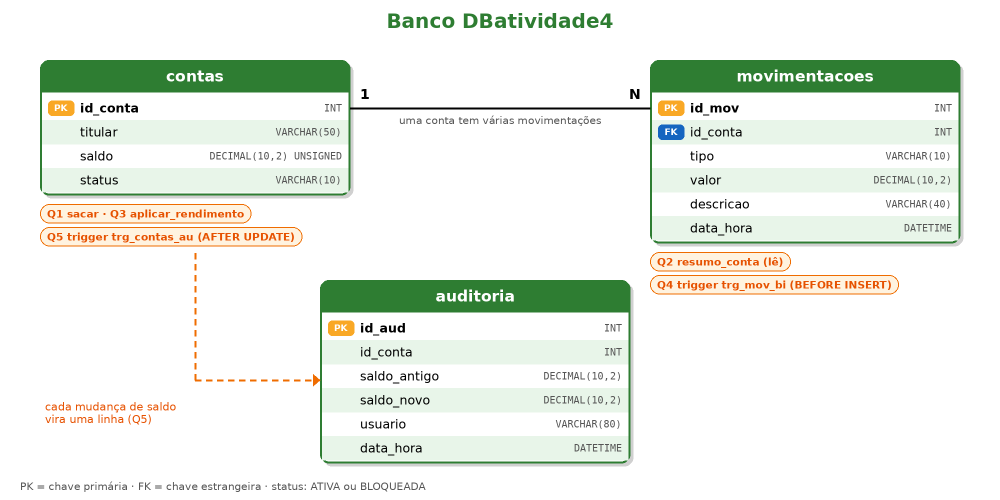

# Atividade-04 – Stored Procedures e Triggers

**IFPI Campus Floriano · TADS – Módulo III · Banco de Dados II · 2026.2**
Prof. Me. Robson Pires Borges

| Duração | Valor | Banco | Formato |
|---|---|---|---|
| 100 minutos | 10,0 (5 questões × 2,0) | `DBatividade4` | individual ou em dupla |

Nesta atividade você vai **criar procedures e triggers** num banco de uma
pequena conta bancária, **testar** cada uma e **mostrar e entregar** o que fez.



---

## 1. Como começar

1. Pegue os arquivos:
   - com conta no GitHub: botão verde **Use this template → Create a new repository**
     e depois `git clone` do **seu** repositório; ou
   - sem conta: **Code → Download ZIP**.
2. No MySQL (terminal, phpMyAdmin, Workbench… você escolhe), rode o arquivo
   **`sql/01_criar_banco.sql`** inteiro. Ele cria o banco `DBatividade4` com as
   tabelas e os dados iniciais.
3. Escreva o seu nome no **`ENTREGA.md`** e no topo de cada arquivo de questão.

> O nome do banco é `DBatividade4` (com **D** e **B** maiúsculos): use `USE DBatividade4;`.

## 2. O que tem aqui

```text
sql/
  01_criar_banco.sql              ← cria o banco com a estrutura e os dados (rode 1 vez)
  02_voltar_dados_iniciais.sql    ← volta aos dados iniciais SEM apagar o que você criou
questoes/
  Q1_procedure_sacar.sql          ← modelos para você preencher
  Q2_procedure_resumo_conta.sql
  Q3_procedure_aplicar_rendimento.sql
  Q4_trigger_movimentacoes.sql
  Q5_trigger_auditoria.sql
evidencias/                       ← prints dos seus testes (opcional)
ENTREGA.md                        ← nomes + checklist da entrega
```

Cada arquivo da pasta `questoes/` tem 4 partes:

1. **Enunciado**: o que criar, as regras e as mensagens de erro;
2. **SUA RESPOSTA**: o esqueleto para completar (`-- escreva aqui`);
3. **TESTES**: comandos para testar, com o **resultado esperado** ao lado;
4. **RESULTADO OBTIDO**: onde você cola o que o MySQL mostrou (ou salva um print em `evidencias/`).

## 3. As questões

| | O que criar | Tipo | Valor |
|:-:|---|---|:-:|
| 1 | `sacar(p_conta, p_valor)` – saque com 4 validações | procedure | 2,0 |
| 2 | `resumo_conta(p_conta, OUT créditos, OUT débitos, OUT qtd)` | procedure com `OUT` | 2,0 |
| 3 | `aplicar_rendimento(p_taxa, OUT qtd)` – rendimento numa transação | procedure + transação | 2,0 |
| 4 | `trg_mov_bi` – arruma e valida cada movimentação | trigger `BEFORE INSERT` | 2,0 |
| 5 | `trg_contas_au` – guarda o histórico do saldo | trigger `AFTER UPDATE` | 2,0 |

### Dados iniciais

| id | titular | saldo | status |
|:-:|---|--:|---|
| 1 | Ana | 1000.00 | ATIVA |
| 2 | Bruno | 500.00 | ATIVA |
| 3 | Carla | 200.00 | ATIVA |
| 4 | Diego | 0.00 | ATIVA |
| 5 | Elisa | 300.00 | **BLOQUEADA** |

Movimentações: 6 (depósitos iniciais e 2 saques). Soma dos saldos: **2000.00**.

## 4. Como trabalhar em cada questão

1. Abra o arquivo da questão, complete a parte **SUA RESPOSTA** e rode esse trecho no MySQL
   (do `DROP ...` até o `DELIMITER ;`).
2. Rode **`sql/02_voltar_dados_iniciais.sql`** para os testes partirem dos dados iniciais.
3. Rode os **TESTES** um por vez e compare com o resultado esperado.
4. Cole o resultado na parte **RESULTADO OBTIDO** (ou tire um print) e responda à pergunta da questão.
5. **Mostre ao professor** a questão funcionando.

## 5. Cola rápida

```sql
-- procedure
DROP PROCEDURE IF EXISTS nome;
DELIMITER $$
CREATE PROCEDURE nome(IN p_id INT, OUT p_total DECIMAL(10,2))
BEGIN
  DECLARE v_saldo DECIMAL(10,2);
  SELECT saldo INTO v_saldo FROM contas WHERE id_conta = p_id;
  IF v_saldo IS NULL THEN
    SIGNAL SQLSTATE '45000' SET MESSAGE_TEXT = 'Conta não encontrada';
  END IF;
  SET p_total = v_saldo;
END $$
DELIMITER ;
CALL nome(1, @t);  SELECT @t;

-- trigger
DROP TRIGGER IF EXISTS nome_trigger;
DELIMITER $$
CREATE TRIGGER nome_trigger BEFORE INSERT ON tabela
FOR EACH ROW
BEGIN
  SET NEW.coluna = UPPER(TRIM(NEW.coluna));   -- BEFORE pode mudar o NEW
END $$
DELIMITER ;

-- transação dentro da procedure
DECLARE EXIT HANDLER FOR SQLEXCEPTION
BEGIN
  ROLLBACK;
  RESIGNAL;
END;
START TRANSACTION;
  -- ...
COMMIT;
```

- `DELIMITER $$` troca o fim de comando para o MySQL não cortar o bloco no primeiro `;`.
  No phpMyAdmin, use o campo **Delimitador** e apague as linhas `DELIMITER`.
- `OLD` = linha antes da mudança · `NEW` = linha depois (no INSERT só existe `NEW`).
- Para listar o que você criou: `SHOW PROCEDURE STATUS WHERE Db = 'DBatividade4';` e `SHOW TRIGGERS;`

## 6. Entrega

1. Os 5 arquivos de `questoes/` preenchidos (resposta + resultado obtido + perguntas respondidas).
2. `ENTREGA.md` com os nomes e o checklist marcado.
3. Envie pelo canal combinado com o professor: o **link do seu repositório** (com o último *push*)
   **ou** o **ZIP da pasta**.

Bom trabalho! *Regra de negócio boa é aquela que nem o usuário apressado consegue furar.*
